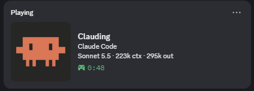

# clauding

Discord Rich Presence for [Claude Code](https://claude.com/claude-code) and the Claude desktop app. Shows the model and live token counts while a session is open.



- Appears when a Claude Code session starts, or (Windows) as soon as the Claude desktop app opens, including chat.
- Disappears when your last session ends or the app closes.
- Several sessions at once are fine: closing one doesn't remove the presence.
- Everything shown is configurable (see [Configuration](#configuration)).
- No dependencies. Talks to Discord over its local IPC pipe.

Unofficial. Not affiliated with Anthropic or Discord.

## Requirements

- Discord **desktop** app running
- Node.js
- Claude Code
- Tested on Windows 11 only. Detecting the desktop app (chat presence) and `autostart` are Windows only.

## Installation

### Plugin (recommended)

```bash
claude plugin marketplace add nishaj0/clauding
claude plugin install clauding@clauding
```

Start a new Claude Code session.

Update:

```bash
claude plugin marketplace update clauding
claude plugin update clauding@clauding
```

Uninstall:

```bash
claude plugin uninstall clauding@clauding
```

### Manual

```bash
git clone https://github.com/nishaj0/clauding.git
cd clauding
node scripts/install.js
```

This adds the hooks to `~/.claude/settings.json` pointing at this folder, so keep the folder where it is. Remove them with `node scripts/install.js --remove`. Use either the plugin or the manual install, not both.

## Chat in the Claude desktop app

Chat has no hooks, so something has to be running before you open it. Set `"autostart": true` in the config: a hidden launcher is added to your Windows Startup folder (`clauding.vbs`) and starts the presence process at login. It idles using a few MB and checks every 2 seconds whether the app is open. Set it back to `false` to remove the launcher.

Without `autostart`, the presence starts with your first Claude Code session and stays up while the app is open.

## Configuration

A config file is created at `~/.claude/clauding.json` on the first session start. Edit it and save; changes apply within a few seconds. If the file has a syntax error, the last valid config stays in use. Deleting the file restores the defaults.

```json
{
  "details": "Claude Code",
  "state": "{status} · {model} · {ctx} ctx · {out} out",
  "largeText": "{project}",
  "appDetails": "Claude",
  "show": { "app": true, "status": false, "model": true, "tokens": true, "project": true, "timer": true },
  "statusText": { "working": "Working...", "idle": "Idle" },
  "autostart": false,
  "buttons": [{ "label": "Get Clauding", "url": "https://github.com/nishaj0/clauding" }]
}
```

| Option | What it does |
|---|---|
| `details` | Top line during a Claude Code session. Any text. |
| `state` | Second line during a Claude Code session. Any text. |
| `largeText` | Tooltip when hovering the crab. |
| `appDetails` | Top line while the desktop app is open with no Claude Code session (chat). |
| `show.app` | Show the presence whenever the desktop app is open (Windows). Off = only during Claude Code sessions. |
| `show.status` | Show `statusText.working` / `statusText.idle` (off by default). |
| `show.model` | Show the model name. |
| `show.tokens` | Show context size (`ctx`) and total output tokens (`out`). |
| `show.project` | Make the project folder name available as `{project}`. |
| `show.timer` | Show the elapsed-time counter. |
| `statusText` | The words used for `{status}`. |
| `autostart` | Start at Windows login, see [above](#chat-in-the-claude-desktop-app). |
| `buttons` | Up to 2 `{label, url}` links on your profile card. `[]` removes them. Other people see them, you don't. |

Placeholders for the text options: `{status}` `{model}` `{ctx}` `{out}` `{project}`.
Segments are separated by ` · `. A segment is left out when it uses a placeholder that is empty or turned off, so turning off `show.tokens` removes `129k ctx · 63k out` and nothing else. Discord needs each line to be at least 2 characters, otherwise it is omitted.

Example, a custom line with the status on:

```json
{
  "details": "Building {project}",
  "state": "{status} · {model}",
  "show": { "status": true, "tokens": false }
}
```

## How it works

Claude Code hooks (`SessionStart`, `UserPromptSubmit`, `Stop`, `SessionEnd`) run `src/presence.js`, which saves that session's state in its own small file and starts a background process if none is running. The process checks every 2 seconds, sends at most one update per 5 seconds, and shows the most recently active session. A session that has been silent for 30 minutes is dropped. The model and token numbers are read from the session transcript on your machine.

On Windows it also checks whether the desktop app is open by looking for the lockfile Chromium keeps at `%APPDATA%\Claude\lockfile` while the app runs. When the app quits, the presence is cleared and sessions that started while it was open are dropped, even if no `SessionEnd` hook ran.

The process exits when there is nothing to show (or keeps idling if `autostart` is on), and reconnects if Discord restarts.

## Development

```bash
npm test
```

## License

[MIT](LICENSE)
